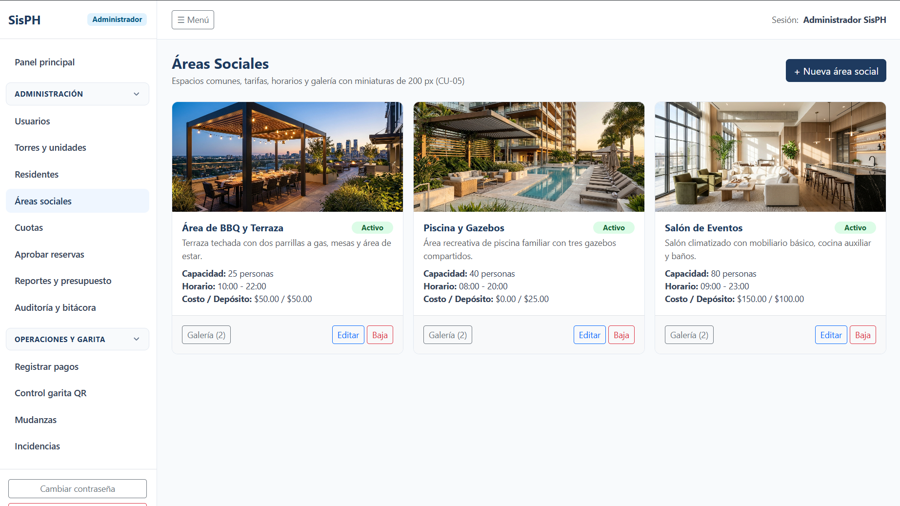
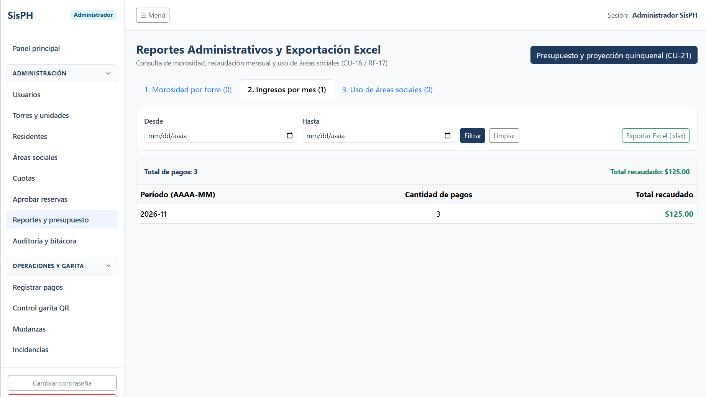
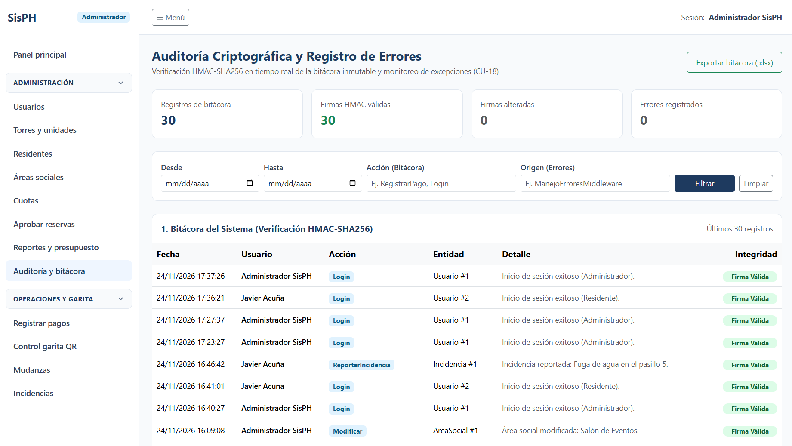

# SisPH — Sistema de Administración de Propiedad Horizontal

> **📅 Fecha:** 24/11/2026

## 📋 Contenido del Repositorio

Este repositorio contiene la implementación integral de **SisPH**, una plataforma web de gestión administrativa, financiera, operativa y de seguridad para conjuntos residenciales bajo régimen de **Propiedad Horizontal**, desarrollada en **C# con ASP.NET Core 10.0 MVC** y **SQL Server 2022 Express**.

La solución está diseñada bajo una **arquitectura en 5 capas** (`SisPH.Entidades`, `SisPH.Seguridad`, `SisPH.Datos`, `SisPH.Negocio` y `SisPH.Web`) aplicando los principios **SOLID** y **DRY**, acceso a datos mediante **Entity Framework Core** y procedimientos almacenados, autenticación por cookies seguras con **BCrypt**, integridad criptográfica **HMAC-SHA256** en bitácora, recibos de pago y reservas aprobadas, generación de códigos **QR**, exportación de reportes a **Excel (`.xlsx`)** y cumplimiento de controles **OWASP Top 10** y la **Ley 81 de 2019** de Protección de Datos Personales de Panamá.

### 📦 Entregables Externos

* **Respaldo de Base de Datos (`SisPH.bak` con datos de prueba precargados):** [Descargar SisPH.bak desde OneDrive](https://utpac-my.sharepoint.com/:u:/g/personal/javier_acuna_utp_ac_pa/IQDPNy5vzDTJS7XkyXqvcFKTAU1lO3v7xsH70fj75aidx5s?e=5X0fgG)

### 🛠️ Tecnologías Utilizadas

* **Lenguaje / Framework:** C# / ASP.NET Core 10.0 (LTS) MVC (Arquitectura modular de 5 proyectos en solución `SisPH.slnx`)

* **Base de datos y ORM:** SQL Server 2022 Express + Entity Framework Core 10 (`Microsoft.EntityFrameworkCore.SqlServer`)

* **Seguridad y Criptografía:** `BCrypt.Net-Next` (factor de costo 12), `HMAC-SHA256` con comparación en tiempo constante (`CryptographicOperations.FixedTimeEquals`), Cookies `HttpOnly` / `Secure` / `SameSite=Strict`, revalidación continua en BD (`OnValidatePrincipal`), filtro global `AuthorizeFilter` y validación `AutoValidateAntiforgeryToken`

* **Librerías Complementarias:** `QRCoder` (códigos QR en PNG/Base64), `ClosedXML` (exportación a `.xlsx`), `SixLabors.ImageSharp` `4.1.4` (miniaturas de `200 px` sin vulnerabilidades NuGet), `Serilog` (bitácora técnica diaria en `logs/`)

* **Frontend:** Razor Views, HTML5 Semántico, CSS3 (Modo claro minimalista con barra lateral colapsable), Bootstrap 5, JavaScript

* **Herramientas:** Microsoft Visual Studio 2026, SQL Server Management Studio 22 (SSMS), Git & GitHub

### 🧩 Componentes y Arquitectura Implementada

* **Capa de Entidades (`SisPH.Entidades`):** 18 entidades de dominio alineadas al modelo relacional, 8 enumeraciones tipadas, interfaz `IDesactivable` para baja lógica y DTO `MorosidadView` mapeado a la vista `vw_Morosidad`.

* **Capa de Seguridad (`SisPH.Seguridad`):** Contrato `ITransformacionSegura` con inyección por clave (`AddKeyedScoped`) implementando `HashBCrypt` (contraseñas) y `FirmaHmacSha256` (sellado de bitácora, recibos de pago y reservas aprobadas).

* **Capa de Datos (`SisPH.Datos`):** `SisPHDbContext`, repositorio genérico `RepositorioBase<T>` (`IRepositorio<T>`), `RepositorioLogError` e invocación de procedimientos almacenados (`sp_GenerarCuotas`, `sp_ActualizarEstadosCuota`).

* **Capa de Negocio (`SisPH.Negocio`):** 17 servicios desacoplados (`ServicioBitacora`, `ServicioQR`, `ServicioArchivos`, `ExportadorExcel`, `ServicioAutenticacion`, `ServicioUsuarios`, `ServicioUnidades`, `ServicioResidentes`, `ServicioAreas`, `ServicioCuotas`, `ServicioPagos`, `ServicioReservas`, `ServicioIncidencias`, `ServicioPases`, `ServicioMudanzas`, `ServicioCuenta` y `ServicioReportes`).

* **Capa de Presentación (`SisPH.Web`):** 15 controladores MVC protegidos por rol (`Administrador`, `Operador`, `Residente`), `ManejoErroresMiddleware`, `ForzarCambioPasswordFilter`, plantilla maestra `_Layout.cshtml` con secciones colapsables, visor lightbox para galerías y vistas parciales reutilizables (`_BadgeEstado`, `_GaleriaImagenes`).

## 📸 Capturas de Pantalla y Problemas Resueltos

### Arquitectura y Problemas Resueltos

* **Problema / Requisito #1 (Arquitectura en 5 Capas, SOLID y DRY):** Se desacopló la lógica de negocio y persistencia en cinco bibliotecas independientes (`Entidades`, `Seguridad`, `Datos`, `Negocio`, `Web`), centralizando las operaciones CRUD en `RepositorioBase<T>`, la exportación tabular en `ExportadorExcel` y la visualización de estados y galerías en vistas parciales reutilizables.

* **Problema / Requisito #2 (Auditoría Inmutable y Detección de Alteraciones con HMAC-SHA256):** Se protegió la tabla `Bitacora` mediante el disparador `TR_Bitacora_SoloInsertar` en SQL Server (bloqueando `UPDATE` y `DELETE`) y firmando cada registro con `HMAC-SHA256` bajo cultura determinista (`InvariantCulture`). El módulo de Auditoría (`CU-18`) recalcula cada firma en tiempo real para alertar visualmente si una fila fue alterada directamente en la base de datos.

* **Problema / Requisito #3 (Transacciones Serializables de Pagos y Recibos Verificables con QR):** El registro de pagos (`CU-07` / `CU-20`) soporta abonos parciales y cancelación múltiple de cuotas dentro de una transacción `Serializable` para evitar dobles cobros simultáneos, generando un recibo firmado digitalmente con código QR verificable públicamente mediante firma HMAC en tiempo constante (`/Pagos/Verificar/{id}?f=...`).

* **Problema / Requisito #4 (Control de Acceso en Garita mediante Pases QR Temporales):** Los residentes generan desde su portal pases de visita con tokens únicos de 32 caracteres y vigencia máxima de 24 horas (`CU-12`); en garita (`CU-13`) el operador escanea el código para registrar entrada y salida en tiempo real, rechazando pases vencidos, inexistentes o reutilizados.

* **Problema / Requisito #5 (Reglas de Paz y Salvo Dinámico, Multimedia y Control OWASP Top 10):** Se implementó cálculo dinámico de solvencia financiera (`CU-19`) antes de solicitar o aprobar reservas y mudanzas, prorrateo global de coeficientes ($\le 100\%$ en todo el PH), bloqueo por fuerza bruta (5 intentos fallidos / 15 minutos), cambio obligatorio de contraseña temporal en el primer inicio de sesión, validación de archivos de imagen ($\le 2\text{ MB}$) con miniaturas de `200 px` y captura global de excepciones sin exposición de trazas al usuario final.

### 1. Página Pública e Inicio de Sesión por Roles (`CU-17` y `CU-01`)

*Vista informativa pública aislada del menú interno y formulario de autenticación protegido contra fuerza bruta:*


### 2. Gestión de Torres, Unidades y Residentes (`CU-03` y `CU-04`)

*Administración de apartamentos, control global de coeficientes de participación en el PH y registro transaccional de propietarios e inquilinos:*


### 3. Catálogo de Áreas Sociales y Galería Interactiva (`CU-05`)

*Gestión de espacios comunes, tarifas, horarios y visualización ampliada de fotografías:*



### 4. Generación de Cuotas y Recibo Digital Firmado con QR (`CU-06`, `CU-07` y `CU-20`)

*Cálculo proporcional por coeficiente y emisión de comprobante de pago con firma HMAC-SHA256 y código QR:*


### 5. Portal del Residente y Generación de Pases de Visita QR (`CU-15` y `CU-12`)

*Consulta de estado de cuenta (paz y salvo dinámico) y creación de pases QR temporales para visitantes:*


### 6. Control de Garita y Validación de Visitantes (`CU-13`)

*Escaneo de token QR en garita con registro automático de entrada y salida en el historial del día:*


### 7. Reportes Financieros, Exportación Excel y Proyección Quinquenal (`CU-16` y `CU-21`)

*Consulta de morosidad por torre, exportación a `.xlsx` y proyección presupuestaria a 5 años:*



### 8. Auditoría Criptográfica y Base de Datos SQL Server 2022 (`CU-18`)

*Verificación de firmas HMAC-SHA256 en bitácora y estructura relacional de 18 tablas en SQL Server Management Studio:*



## 📂 Estructura de Carpetas o Directorios

```text
SisPH/
├── SisPH.Entidades/                # Capa 1: Entidades de dominio, Enums, Interfaces y DTOs
│   ├── DTOs/                       # MorosidadView (mapeo de vw_Morosidad)
│   ├── Entidades/                  # 18 clases del modelo relacional (Usuario, Unidad, Cuota, Pago, etc.)
│   ├── Enums/                      # Enumeraciones (Rol, EstadoCuota, MetodoPago, EstadoReserva, etc.)
│   └── Interfaces/                 # IDesactivable (baja lógica)
├── SisPH.Seguridad/                # Capa 2: Implementaciones criptográficas
│   ├── ITransformacionSegura.cs    # Contrato común de transformación y verificación
│   ├── HashBCrypt.cs               # Hashing de contraseñas con BCrypt (factor 12)
│   └── FirmaHmacSha256.cs          # Firma y verificación HMAC-SHA256 en tiempo constante
├── SisPH.Datos/                    # Capa 3: Acceso a datos con Entity Framework Core
│   ├── Contexto/                   # SisPHDbContext (mapeo de 18 tablas, vista y SPs)
│   ├── Interfaces/                 # IRepositorio<T>, IRepositorioLogError
│   └── Repositorios/               # RepositorioBase<T>, RepositorioLogError
├── SisPH.Negocio/                  # Capa 4: Lógica de negocio y servicios transversales
│   ├── Interfaces/                 # 17 contratos de servicios (SOLID)
│   ├── Modelos/                    # ResultadoOperacion y ResultadoOperacion<T>
│   └── Servicios/                  # 17 servicios de casos de uso, QR, Excel, Bitácora e Imágenes
├── SisPH.Web/                      # Capa 5: Aplicación web ASP.NET Core 10.0 MVC
│   ├── Controllers/                # 15 controladores MVC organizados por rol y módulo
│   ├── Extensions/                 # ClaimsPrincipalExtensions (lectura de sesión)
│   ├── Filters/                    # ForzarCambioPasswordFilter (cambio obligatorio de clave temporal)
│   ├── Middleware/                 # ManejoErroresMiddleware (captura global RNF-06)
│   ├── Models/                     # ViewModels con DataAnnotations
│   ├── Views/                      # Vistas Razor, _Layout.cshtml y parciales DRY
│   ├── wwwroot/                    # CSS, Bootstrap 5 y carpeta uploads/ (areas, residentes, incidencias)
│   ├── appsettings.json            # Configuración base de conexión y parámetros financieros
│   └── Program.cs                  # Inyección de dependencias, Serilog, Cookies y Antiforgery
├── script/
│   └── SisPH.sql                   # Script DDL/DML completo (18 tablas, vista, 2 SPs, trigger y datos semilla)
├── capturas/                       # Evidencias visuales del sistema para documentación
├── logs/                           # Archivos diarios de log técnico generados por Serilog
├── .gitignore                      # Exclusión de bin/, obj/, .vs/, logs/, *.bak y archivos sensibles
├── SisPH.slnx                      # Archivo de solución de Visual Studio
└── README.md                       # Documentación del proyecto
```

## 🚀 Instrucciones de Ejecución / Uso

Pasos para configurar y ejecutar el proyecto en un entorno local:

1. **Clonar el repositorio:**

   ```bash
   git clone https://github.com/jacu2006/SisPH.git
   cd SisPH
   ```

2. **Restaurar la base de datos en SQL Server 2022 Express:**

   * **Opción A — Respaldo `SisPH.bak` con datos de prueba precargados (Recomendada para evaluación rápida):**
     1. Descargar el archivo `SisPH.bak` desde el enlace externo indicado en la sección **Entregables Externos** al inicio de este documento y copiarlo en la carpeta de respaldos de SQL Server (`C:\Program Files\Microsoft SQL Server\MSSQL16.SQLEXPRESS\MSSQL\Backup\`).
     2. Abrir **SQL Server Management Studio (SSMS 22)** conectado a `localhost\SQLEXPRESS`, hacer clic derecho sobre **Bases de datos → Restaurar base de datos...**, seleccionar **Dispositivo**, elegir `SisPH.bak` y confirmar la restauración.

   * **Opción B — Instalación limpia desde cero mediante script SQL:**
     1. Abrir el archivo `script/SisPH.sql` en SSMS 22 y ejecutarlo para crear la base de datos `SisPH` (`AUTO_CLOSE OFF`), las 18 tablas, la vista `vw_Morosidad`, los procedimientos almacenados, el trigger de bitácora y la cuenta inicial de administrador (`admin@sisph.com`).

3. **Configurar la cadena de conexión y clave criptográfica (`User Secrets`):**

   * Verificar que `SisPH.Web/appsettings.json` apunte a tu instancia local (`Server=localhost\SQLEXPRESS;Database=SisPH;Trusted_Connection=True;TrustServerCertificate=True;`).

   * Configurar la clave secreta `Crypto:FirmaKey` (Base64 de 32 bytes / 256 bits) en `SisPH.Web` ejecutando en terminal:

   ```bash
   dotnet user-secrets init --project SisPH.Web
   dotnet user-secrets set "Crypto:FirmaKey" "<clave-base64-256-bits>" --project SisPH.Web
   ```

4. **Compilar y ejecutar en Visual Studio 2026:**

   * Abrir `SisPH.slnx` en **Visual Studio 2026**.

   * Establecer **`SisPH.Web`** como proyecto de inicio y presionar `F5` (o ejecutar `dotnet run --project SisPH.Web`).

### 🔑 Credenciales de Acceso

* **Instalación limpia con `script/SisPH.sql`:** Incluye únicamente la cuenta raíz de administrador (`admin@sisph.com` / `Admin123*`) siguiendo el principio de menor privilegio para dar de alta usuarios operativos y residentes desde el sistema.
* **Base de datos restaurada desde `SisPH.bak`:** Contiene precargados los tres perfiles operativos para probar todos los flujos de inmediato:

| Rol | Usuario / Perfil | Correo Electrónico | Contraseña | Escenario Precargado en `SisPH.bak` |
| :--- | :--- | :--- | :--- | :--- |
| **Administrador** | Administrador SisPH | `admin@sisph.com` | `Admin123*` | Control total: torres, unidades (`100 %` global), cuotas, aprobación de reservas, reportes y auditoría HMAC. |
| **Operador** | Carlos Mendoza (Garita) | `operador@sisph.com` | `Operador123*` | Registro de pagos con recibo QR, validación de pases de visita en garita e incidencias. |
| **Residente (Al día)** | Valeria Gómez (`Torre Norte - 101`) | `valeria@sisph.com` | `Residente123*` | Estado **Paz y Salvo**, recibo firmado con QR, reserva aprobada con QR y pase vigente para garita. |
| **Residente (Moroso)** | Ricardo Morales (`Torre Sur - 201`) | `ricardo@sisph.com` | `Residente123*` | Cuota vencida de `$75.00` para demostrar el bloqueo automático de reservas y mudanzas sin Paz y Salvo. |

## 👥 Autores y Contexto

* **Integrantes del Equipo:**
  * Elvis Li
  * Wilson Wu
  * Javier Acuña

* **Grupo:** `1IL133`

* **Asignatura:** Herramientas de la Programación Aplicada III (.Net)

* **Instructora:** Ing. Irina Fong

* **Institución:** Universidad Tecnológica de Panamá (UTP) — Facultad de Ingeniería de Sistemas Computacionales (FISC)

* **Fecha de Realización:** 24/11/2026

## 📚 Referencias

* [Documentación Oficial de ASP.NET Core 10.0 MVC](https://learn.microsoft.com/es-es/aspnet/core/mvc/overview)

* [Documentación Oficial de Entity Framework Core](https://learn.microsoft.com/es-es/ef/core/)

* [OWASP Top 10 — Riesgos de Seguridad en Aplicaciones Web](https://owasp.org/www-project-top-ten/)

* [Ley 81 de 26 de marzo de 2019 — Protección de Datos Personales (República de Panamá)](https://www.gacetaoficial.gob.pa/)

* [Librerías Open Source: QRCoder, ClosedXML, SixLabors.ImageSharp y BCrypt.Net-Next](https://www.nuget.org/)